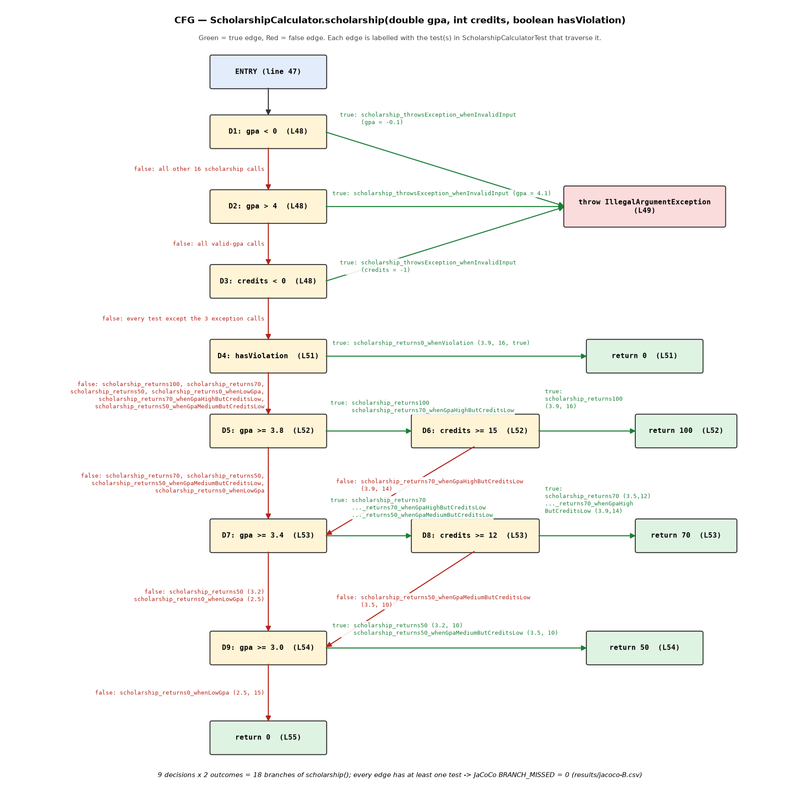

# Lab 09 — JaCoCo Code Coverage & Structural Testing

**Хичээл:** F.CSA313 — Программ хангамжийн чанарын баталгаа ба туршилт  
**Сэдэв:** Бүтцийн тест ба кодын хамрах хүрээ (Code Coverage)  
**Төсөл:** Scholarship Calculator  
**Оюутны нэр:** А.Төгөлдөр  
**Оюутны код:** B242270001  
**Хөгжүүлэлтийн орчин:** VS Code, Ubuntu (WSL2)

### Орчны мэдээлэл (Version Outputs)
`java -version`
```text
openjdk version "25.0.4.1" 2026-08-18
OpenJDK Runtime Environment (build 25.0.4.1+1-1-26.04.4-Ubuntu)
OpenJDK 64-Bit Server VM (build 25.0.4.1+1-1-26.04.4-Ubuntu, mixed mode, sharing)

```

`mvn -version`

```text
Apache Maven 3.9.12
Maven home: /usr/share/maven
Java version: 25.0.4.1, vendor: Ubuntu, runtime: /usr/lib/jvm/java-25-openjdk-amd64
Default locale: en, platform encoding: UTF-8
OS name: "linux", version: "6.18.33.2-microsoft-standard-wsl2", arch: "amd64", family: "unix"

```

---

## 1. Лабораторийн ажлын зорилго

Энэхүү лабораторийн ажлын зорилго нь Java программын бүтцийг шинжлэх, бүтцийн тест боловсруулах, тестийн хамрах хүрээг хэмжих болон программын логик алдааг илрүүлж засахад оршино.

Лабораторийн хүрээнд дараах ажлуудыг гүйцэтгэв:

* JUnit 5 ашиглан нэгжийн тест (Unit Test) боловсруулах.
* JaCoCo ашиглан кодын хамрах хүрээг (Code Coverage) хэмжих.
* Control Flow Graph (CFG) байгуулж программын гүйцэтгэлийн урсгалыг шинжлэх.
* Line Coverage болон Branch Coverage-ийг бүрэн хамруулах.
* Давталтын хилийн утгуудыг (Loop Boundary) тестлэх.
* Boundary Value Analysis ашиглан логик алдаа илрүүлж засах.
* Git ашиглан хөгжүүлэлтийн үе шат бүрийн өөрчлөлтийг хувилбаржуулах.

---

## 2. Төслийн тухай

Энэхүү төсөл нь оюутны авсан оноогоор үсгэн үнэлгээ тодорхойлох, голч дүн тооцоолох, тэтгэлгийн хэмжээг тогтоох зориулалттай Java программ юм (`ScholarshipCalculator`).

---

## 3. Хэсэг A: Happy path тестүүд ба эхний хэмжилт

Эхний ээлжинд хэвийн урсгалыг шалгах 5 тестийг бичиж (commit `c03a42a`), өмнөх хэмжилт хуримтлагдахгүйн тулд `mvn clean verify` ажиллуулсан. `results/mvn-verify-A.txt`: `Tests run: 5, Failures: 0`. `results/jacoco-A.csv` файлаас харахад:

* **Line Coverage (А):** 64.0% (16/25 мөр, 9 мөр хамрагдаагүй)
* **Branch Coverage (А):** 53.7% (22/41 салаа, 19 салаа хамрагдаагүй)
* **Instruction Coverage (А):** 71.1% (108/152)

Happy path тестүүд нь алдааны салаа (exception), сахилгын зөрчил, `credits` нөхцөл худал болох салаа зэргийг дайраагүй тул 100% хүрээгүй.

---

## 4. Хэсэг B: CFG зурж Branch 100% хүрэх

`scholarship()` болон бусад функцүүдийн Control Flow Graph (CFG)-ийг зурж `docs/cfg-scholarship.png` байдлаар репод оруулсан. Диаграммд зангилаа бүр кодын бодит нөхцөл (мөрийн дугаартай: D1 `gpa < 0`, D2 `gpa > 4`, D3 `credits < 0`, D4 `hasViolation`, D5 `gpa >= 3.8`, D6 `credits >= 15`, D7 `gpa >= 3.4`, D8 `credits >= 12`, D9 `gpa >= 3.0`), ирмэг бүр true/false болон түүнийг дайрах тестийн нэрээр тэмдэглэгдсэн. 9 шийдвэр × 2 = 18 салаа бүгд дор хаяж нэг тесттэй.



### `scholarship()` методын CFG ба Ирмэгийн тестийн холбоос:

`ScholarshipCalculator.java` доторх `scholarship(double gpa, int credits, boolean hasViolation)` методын бодит кодын нөхцөлүүд болон ирмэг бүр дээрх тестийн нэрс:

| Салаа / Ирмэг (Edge) | Шалгах нөхцөл (Бодит код) | Харгалзрах тестийн нэр (`ScholarshipCalculatorTest.java`) |
| --- | --- | --- |
| **Input Validation (GPA < 0)** | `gpa < 0` | `scholarship_throwsException_whenInvalidInput()` |
| **Input Validation (GPA > 4)** | `gpa > 4` | `scholarship_throwsException_whenInvalidInput()` |
| **Input Validation (Credits < 0)** | `credits < 0` | `scholarship_throwsException_whenInvalidInput()` |
| **Violation Check** | `hasViolation == true` | `scholarship_returns0_whenViolation()` |
| **100% Scholarship** | `gpa >= 3.8 && credits >= 15` | `scholarship_returns100()` |
| **70% Scholarship (1)** | `gpa >= 3.8` (credits < 15) | `scholarship_returns70_whenGpaHighButCreditsLow()` |
| **70% Scholarship (2)** | `gpa >= 3.4 && credits >= 12` | `scholarship_returns70()` |
| **50% Scholarship (1)** | `gpa >= 3.4` (credits < 12) | `scholarship_returns50_whenGpaMediumButCreditsLow()` |
| **50% Scholarship (2)** | `gpa >= 3.0` | `scholarship_returns50()` |
| **Else / Default (0)** | `gpa < 3.0` | `scholarship_returns0_whenLowGpa()` |

* **Тестийн тоо:** `results/mvn-verify-B.txt` файлаас харахад нийт **17 тест** амжилттай ажилласан (`Tests run: 17, Failures: 0, Errors: 0, Skipped: 0`). Энэ хэмжилтийг 60-ын заагийн засварын дараах commit `eb71ead` дээр `mvn clean verify`-ээр авсан.
* **JaCoCo үр дүн (B):** `results/jacoco-B.csv` — Line 25/25 (100%), Branch 41/41 (100%), `BRANCH_MISSED = 0`, `LINE_MISSED = 0`.
* **Эцсийн үр дүн:** Хэсэг C-ийн 2 давталтын тест нэмэгдсэний дараа `results/mvn-verify-final.txt`-д `Tests run: 19`, `results/jacoco-final.csv`-д Line 25/25, Branch 41/41 хэвээр.

| Үе шат | Тест | Line | Branch | Файл |
| --- | --- | --- | --- | --- |
| A | 5 | 16/25 (64.0%) | 22/41 (53.7%) | `results/jacoco-A.csv` |
| B | 17 | 25/25 (100%) | 41/41 (100%) | `results/jacoco-B.csv` |
| Final | 19 | 25/25 (100%) | 41/41 (100%) | `results/jacoco-final.csv` |

Бүх хэмжилтийг `mvn clean verify`-ээр (өмнөх `target/jacoco.exec` устгагдсан) авсан тул үе шат бүрийн хувь зөвхөн тухайн үеийн тестүүдийг илэрхийлнэ.

---

## 5. Хэсэг C: Давталтын заагийн тестүүд (`gpa()` loop testing)

`gpa()` методын давталтад зориулж 3 төрлийн заагийн тестийг нэмсэн:

1. **0 элемент (Хоосон массив/null):** `assertThrows` ашиглан `IllegalArgumentException` шалгасан (`gpa_throwsException_whenNullOrEmpty`).
2. **1 элемент (`{95}`):** Ганц утгатай үеийн давталтын ажиллагааг шалгасан (`gpa_calculatesAverage_withOneElement`).
3. **Олон элемент (`{95, 85, 75, 65, 40}`):** Олон давталттай үеийн нийлбэр ба хуваарь зөв ажиллаж буйг шалгасан (`gpa_calculatesAverage_withMultipleElements`).

---

## 6. Хэсэг D: Зааг утгын алдаа ба амьд үлдсэн алдааг илрүүлэх

### 6.1. Унасан тестийн гаралт (`results/mvn-test-D-fail.txt`)

Кодын хамралт 100% болсон хэдий ч спецификацийн дагуу 60 оноог "D" үнэлгээнд хамруулах үед анхны кодонд байсан `score > 60` гэсэн логик алдааны улмаас засварын өмнөх commit `97bbc45` (17 тест) дээр `mvn clean test` ажиллуулахад дараах алдаа гарч тест унасан:

```text
[ERROR] Tests run: 17, Failures: 1, Errors: 0, Skipped: 0 <<< FAILURE! -- in mn.edu.must.sqat.ScholarshipCalculatorTest
[ERROR] mn.edu.must.sqat.ScholarshipCalculatorTest.letterGrade_returnsD <<< FAILURE!
org.opentest4j.AssertionFailedError: expected: <D> but was: <F>
[ERROR]   ScholarshipCalculatorTest.letterGrade_returnsD:32 expected: <D> but was: <F>
[INFO] BUILD FAILURE
```

### 6.2. Алдааны засвар ба Commit

* **Алдааны шалтгаан:** `letterGrade()` дотор `if (score > 60) return "D";` гэж бичсэн байсан нь яг 60 оноо авсан оюутныг `D` бус шууд `F` болгож байв.
* **Засвар:** Уг нөхцөлийг `if (score >= 60) return "D";` болгон засаж тусдаа commit хийсэн.
* **Commit message:** `fix: correct letter grade boundary at 60 (> 60 to >= 60)`

### 6.3. Лабораторийн гол дүгнэлт

Branch болон Line хамралт 100% байх нь кодын бүх зангилаа болон салаанууд тестээр дайран өнгөрснийг баталгаажуулдаг боловч тухайн нөхцөлийн доторх оператор (`>` ба `>=`) буруу байхад түүнийг дангаараа илрүүлж чадахгүй байж болдгийг энэхүү лабаар олж харлаа. Өөрөөр хэлбэл, **код хамралт бол зайлшгүй шаардлагатай хэрэгсэл мөн боловч хангалттай нотолгоо биш юм**. Тиймээс бүтцийн тестийг зааг утгын шинжилгээ (Boundary Value Analysis)-тэй хослуулан хэрэглэх нь програм хангамжийн чанарыг баталгаажуулахад чухал үүрэгтэй.

---

## 7. Дүгнэлт

Энэхүү лабораторийн ажлаар Java программын бүтцийн тест боловсруулж, JUnit 5 болон JaCoCo хэрэгслүүдийг ашиглан кодын хамрах хүрээг хэмжиж сурсан.

`ScholarshipCalculator` классын үндсэн гурван method-д CFG шинжилгээ хийж, нөхцөлт салаалал болон давталтын ажиллагааг тестээр шалгасан. Үүний үр дүнд Instruction, Branch, Line, Method болон Class Coverage үзүүлэлтүүдийг 100%-д хүргэсэн.

Мөн Boundary Value Analysis ашиглан 60 онооны зааг дээрх логик алдааг илрүүлж, эх кодыг засварлан дахин тестэлсэн.

Энэхүү лабораторийн ажлаас авсан гол сургамж нь өндөр Code Coverage нь кодын бүх хэсэг ажилласныг харуулдаг боловч логик зөв байдлыг бүрэн батлахгүй. Иймээс бүтцийн тестийг boundary value болон шаардлагад суурилсан тесттэй хослуулах нь программын чанарыг сайжруулахад чухал ач холбогдолтой юм.

```