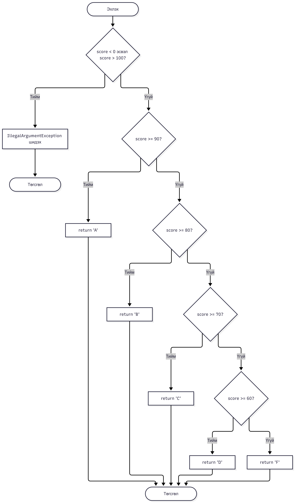
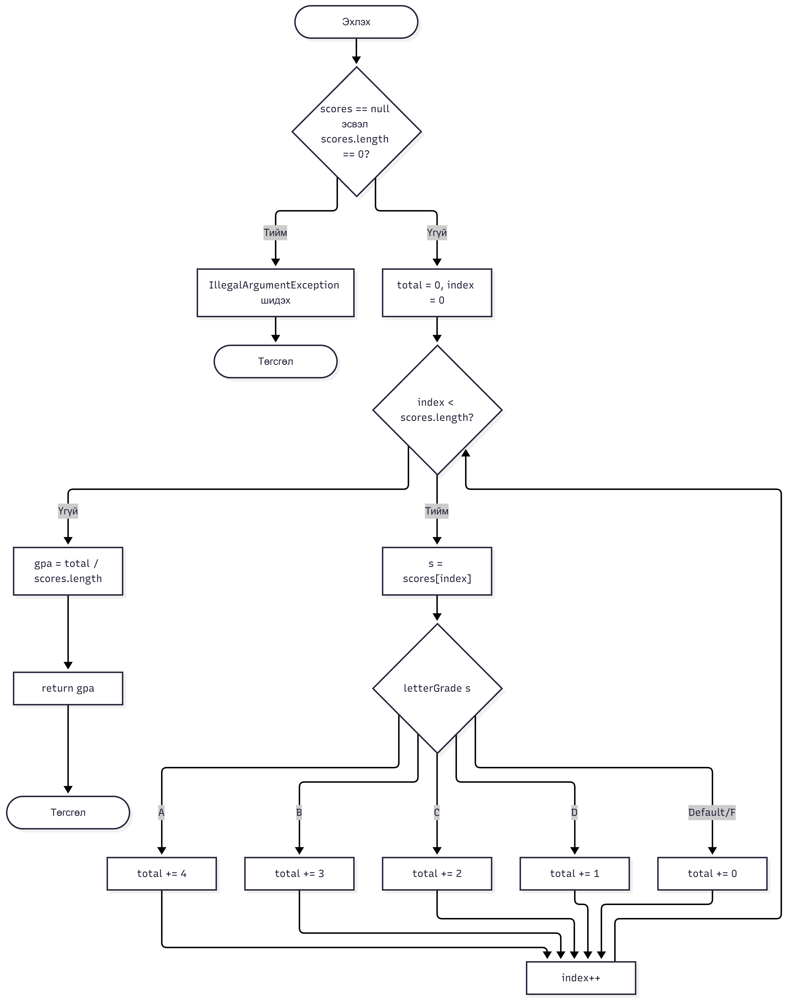
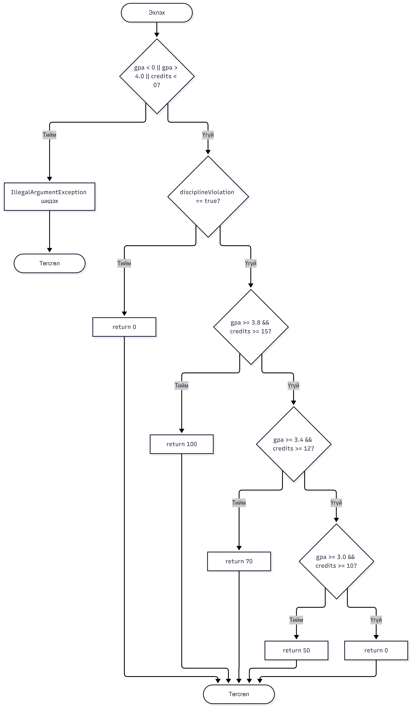

# Lab 09 — JaCoCo Code Coverage & Structural Testing

**Хичээл:** F.CSA313 — Программ хангамжийн чанарын баталгаа ба туршилт  
**Сэдэв:** Бүтцийн тест ба кодын хамрах хүрээ (Code Coverage)  
**Төсөл:** Scholarship Calculator  
**Оюутны нэр:** А.Төгөлдөр  
**Оюутны код:** B242270001  
**Хөгжүүлэлтийн орчин:** VS Code, Ubuntu (WSL2)

### Орчны мэдээлэл (Version Outputs)
`java -version`
```text
openjdk version "25.0.4.1" 2026-08-18
OpenJDK Runtime Environment (build 25.0.4.1+1-1-26.04.4-Ubuntu)
OpenJDK 64-Bit Server VM (build 25.0.4.1+1-1-26.04.4-Ubuntu, mixed mode, sharing)
```
`mvn -version`
```text
Apache Maven 3.9.12
Maven home: /usr/share/maven
Java version: 25.0.4.1, vendor: Ubuntu, runtime: /usr/lib/jvm/java-25-openjdk-amd64
Default locale: en, platform encoding: UTF-8
OS name: "linux", version: "6.18.33.2-microsoft-standard-wsl2", arch: "amd64", family: "unix"
```

---

## 1. Лабораторийн ажлын зорилго

Энэхүү лабораторийн ажлын зорилго нь Java программын бүтцийг шинжлэх, бүтцийн тест боловсруулах, тестийн хамрах хүрээг хэмжих болон программын логик алдааг илрүүлж засахад оршино.

Лабораторийн хүрээнд дараах ажлуудыг гүйцэтгэв:

- JUnit 5 ашиглан нэгжийн тест (Unit Test) боловсруулах.
- JaCoCo ашиглан кодын хамрах хүрээг (Code Coverage) хэмжих.
- Control Flow Graph (CFG) байгуулж программын гүйцэтгэлийн урсгалыг шинжлэх.
- Line Coverage болон Branch Coverage-ийг бүрэн хамруулах.
- Давталтын хилийн утгуудыг (Loop Boundary) тестлэх.
- Boundary Value Analysis ашиглан логик алдаа илрүүлэх.
- Илрүүлсэн алдааг засаж, тестээр дахин баталгаажуулах.
- Git ашиглан хөгжүүлэлтийн үе шат бүрийн өөрчлөлтийг хувилбаржуулах.

## 2. Төслийн тухай

Энэхүү төсөл нь оюутны авсан оноогоор үсгэн үнэлгээ тодорхойлох, голч дүн тооцоолох, тэтгэлгийн хэмжээг тогтоох зориулалттай Java программ юм.

Программын үндсэн класс:

`ScholarshipCalculator`

Тус класс нь дараах гурван үндсэн method-той.

### 2.1. letterGrade()

Оюутны авсан оноог үсгэн үнэлгээнд хөрвүүлнэ.

| Онооны муж | Үнэлгээ |
|---|---|
| 90–100 | A |
| 80–89.99 | B |
| 70–79.99 | C |
| 60–69.99 | D |
| 0–59.99 | F |
| 0-ээс бага, 100-аас их | IllegalArgumentException |

### 2.2. gpa()

Оюутны авсан оноонуудын үсгэн үнэлгээнд харгалзах голч дүнг тооцоолно.

| Үнэлгээ | Голч оноо |
|---|---:|
| A | 4 |
| B | 3 |
| C | 2 |
| D | 1 |
| F | 0 |

Голч дүнг нийт онооны нийлбэрийг массивын элементийн тоонд хувааж тооцно.

`null` эсвэл хоосон массив дамжуулсан тохиолдолд `IllegalArgumentException` үүсгэнэ.

### 2.3. scholarship()

Голч дүн, кредитийн хэмжээ болон сахилгын зөрчил байгаа эсэхэд үндэслэн тэтгэлгийн хэмжээг тодорхойлно.

| Нөхцөл | Тэтгэлэг |
|---|---:|
| Сахилгын зөрчилтэй | 0 |
| GPA ≥ 3.8, кредит ≥ 15 | 100 |
| GPA ≥ 3.4, кредит ≥ 12 | 70 |
| GPA ≥ 3.0 | 50 |
| Бусад тохиолдолд | 0 |

GPA нь 0–4, кредит нь 0-ээс багагүй байх ёстой. Хязгаараас гадуур утга дамжуулбал `IllegalArgumentException` үүсгэнэ.

## 3. Ашигласан технологи, хэрэгслүүд

| Технологи | Хувилбар / Үүрэг |
|---|---|
| Java | OpenJDK 25.0.4.1 |
| Apache Maven | 3.9.12 |
| JUnit Jupiter | 5.10.2 |
| JaCoCo | 0.8.12 |
| Maven Surefire | 3.2.5 |
| VS Code | Код бичих орчин |
| Ubuntu / WSL2 | Ажиллуулах орчин |
| Git | Хувилбарын удирдлага |

## 4. Төслийн бүтэц

```text
F.CSA313_lab09/
│
├── pom.xml
├── README.md
├── .gitignore
│
├── docs/
│   ├── cfg-letter-grade.png
│   ├── cfg-gpa.png
│   ├── cfg-scholarship.png
│   └── index.html
│
├── src/
│   ├── main/
│   │   └── java/
│   │       └── mn/edu/must/sqat/
│   │           └── ScholarshipCalculator.java
│   │
│   └── test/
│       └── java/
│           └── mn/edu/must/sqat/
│               └── ScholarshipCalculatorTest.java
│
└── target/
    ├── surefire-reports/
    └── site/
        └── jacoco/
            ├── index.html
            ├── jacoco.csv
            └── jacoco.xml
```

**Тайлбар:** `target/` хавтас нь Maven-ийн build болон тестийн явцад автоматаар үүсдэг тул `.gitignore` файлд оруулж Git хувилбарын удирдлагаас хассан.

## 5. Бүтцийн тест ба CFG шинжилгээ

Программын кодын гүйцэтгэлийн урсгалыг шинжлэхийн тулд гурван үндсэн method-ийн Control Flow Graph (CFG)-ийг байгуулсан.

CFG нь программын гүйцэтгэлийг зангилаа (Node), шилжилт (Edge), нөхцөлт салаалал (Decision) болон давталтаар дүрслэх боломж олгодог.

### 5.1. letterGrade() методын CFG

Энэхүү граф нь онооны хүчинтэй эсэхийг шалгах, онооны муж бүрт тохирох үнэлгээг буцаах салааллуудыг харуулна.



### 5.2. gpa() методын CFG

Энэхүү граф нь массивын `null` болон хоосон эсэхийг шалгах, `for` давталтаар оноонуудыг боловсруулах, `switch` нөхцөлөөр голч оноо нэмэх гүйцэтгэлийн урсгалыг харуулна.



### 5.3. scholarship() методын CFG

Энэхүү граф нь оролтын утгуудын хүчинтэй эсэхийг шалгах, сахилгын зөрчил болон голч дүн, кредитийн нөхцөлүүдэд үндэслэн тэтгэлгийн хэмжээг тодорхойлох салааллуудыг харуулна.



## 6. Тестийн стратеги

Тест боловсруулахдаа дараах аргуудыг ашигласан.

### 6.1. Statement Coverage

Программын гүйцэтгэгдэх команд бүр тестээр ажилласан эсэхийг шалгасан.

### 6.2. Branch Coverage

Нөхцөлт операторуудын True болон False салаа бүрийг ажиллуулах тестүүд боловсруулсан.

### 6.3. Boundary Value Analysis

Онооны хязгаарын утгууд болон тэтгэлгийн нөхцөлүүдийн зааг дээр тест хийсэн.

Жишээлбэл:

- Оноо 0 болон 100.
- Оноо 60 — D үнэлгээний доод хязгаар.
- GPA 3.8 болон кредит 15.
- GPA 3.4 болон кредит 12.
- GPA 3.0.

### 6.4. Loop Testing

`gpa()` method-ийн `for` давталтыг дараах тохиолдлуудаар шалгасан.

| Тохиолдол | Тестийн оролт | Зорилго |
|---|---|---|
| 0 элемент | Хоосон массив | Хоосон массивын хамгаалалт |
| 1 элемент | `{95}` | Нэг удаагийн давталт |
| Олон элемент | `{95, 85, 75, 65, 40}` | Олон удаагийн давталт |

Хоосон массивын үед давталтад хүрэхээс өмнө exception үүсэх ёстой. Харин нэг болон олон элементтэй массивын үед давталтын ажиллагааг шалгасан.

## 7. Илрүүлсэн логик алдаа ба засвар

Boundary Value Analysis хийх явцад `letterGrade()` method-ийн 60 онооны зааг дээр логик алдаа илрүүлсэн.

### 7.1. Алдааны шалтгаан

Анхны кодод:

```java
if (score > 60) return "D";
```

гэж бичсэн байсан.

Энэ нөхцөл нь яг 60 оноог D үнэлгээнд хамруулахгүй бөгөөд F үнэлгээ буцааж байв.

Гэвч шаардлагын дагуу 60–69.99 оноо D үнэлгээтэй байх ёстой.

### 7.2. Алдааг илрүүлсэн тест

```java
@Test
void letterGrade_returnsD() {
    assertEquals("D", calculator.letterGrade(65));
    assertEquals("D", calculator.letterGrade(60));
}
```

Засвар хийхээс өмнө `mvn test` ажиллуулахад 60 онооны тест амжилтгүй болсон.

### 7.3. Алдааны засвар

Нөхцөлийг дараах байдлаар өөрчилсөн.

```java
if (score >= 60) return "D";
```

Үүний дараа дахин тест ажиллуулахад бүх тест амжилттай болсон.

```bash
mvn clean verify
```

Энэ туршилт нь 100% Code Coverage нь программын логик зөв эсэхийг дангаараа баталгаажуулахгүй бөгөөд boundary value тест чухал болохыг харуулсан.

## 8. Тестийн үр дүн

JUnit 5 ашиглан нийт 19 нэгжийн тест боловсруулж ажиллуулсан.

Тестүүд нь `letterGrade()`, `gpa()`, `scholarship()` method-уудын хэвийн ажиллагаа, нөхцөлт салаалал, буруу оролт болон давталтын ажиллагааг шалгасан.

Тестийн үр дүн:

| Үзүүлэлт | Үр дүн |
|---|---:|
| Нийт тест | 19 |
| Амжилтгүй тест | 0 |
| Алдаа (Errors) | 0 |
| Алгассан тест | 0 |
| Амжилттай тест | 19 |

## 9. JaCoCo Code Coverage

JaCoCo ашиглан тестийн дараах кодын хамрах хүрээг хэмжсэн.

Одоогийн бүрэн хамралтын үр дүн:

| Coverage төрөл | Хамрах хүрээ |
|---|---:|
| Instruction Coverage | 100% |
| Branch Coverage | 100% |
| Line Coverage | 100% |
| Method Coverage | 100% |
| Class Coverage | 100% |

JaCoCo тайланг дараах замаас үзэх боломжтой:

```text
target/site/jacoco/index.html
```

CSV тайлан:

```text
target/site/jacoco/jacoco.csv
```

Тайланг үүсгэхийн тулд:

```bash
mvn clean verify
```

командыг ажиллуулна.

## 10. Программыг ажиллуулах заавар

### Шаардлагатай орчин

- Java Development Kit (JDK)
- Apache Maven
- Git

### 10.1. Repository-г татах

```bash
git clone <repository-url>
cd F.CSA313_lab09
```

### 10.2. Тест ажиллуулах

```bash
mvn test
```

### 10.3. Бүрэн build болон JaCoCo тайлан үүсгэх

```bash
mvn clean verify
```

### 10.4. JaCoCo тайлан үзэх

```bash
code target/site/jacoco/index.html
```

Эсвэл `target/site/jacoco/index.html` файлыг веб хөтөчөөр нээнэ.

## 11. Git хувилбарын удирдлага

Хөгжүүлэлтийн явцад тест нэмэх, логик алдаа засах болон төслийн тохиргоог өөрчлөх үе шатуудыг тусдаа commit-оор хадгалсан.

Жишээ commit-ууд:

```text
test: add initial scholarship calculator tests
test: add full branch coverage tests
fix: correct letter grade boundary at 60
chore: add gitignore for build files
test: cover gpa loop with multiple elements
```

Эдгээр commit-ууд нь тестийн хамрах хүрээг нэмэгдүүлэх, илрүүлсэн алдааг засах үйл явцыг хянах боломж олгоно.

## 12. Дүгнэлт

Энэхүү лабораторийн ажлаар Java программын бүтцийн тест боловсруулж, JUnit 5 болон JaCoCo хэрэгслүүдийг ашиглан кодын хамрах хүрээг хэмжиж сурсан.

`ScholarshipCalculator` классын үндсэн гурван method-д CFG шинжилгээ хийж, нөхцөлт салаалал болон давталтын ажиллагааг тестээр шалгасан. Үүний үр дүнд Instruction, Branch, Line, Method болон Class Coverage үзүүлэлтүүдийг 100%-д хүргэсэн.

Мөн Boundary Value Analysis ашиглан 60 онооны зааг дээрх логик алдааг илрүүлж, эх кодыг засварлан дахин тестэлсэн.

Энэхүү лабораторийн ажлаас авсан гол сургамж нь өндөр Code Coverage нь кодын бүх хэсэг ажилласныг харуулдаг боловч логик зөв байдлыг бүрэн батлахгүй. Иймээс бүтцийн тестийг boundary value болон шаардлагад суурилсан тесттэй хослуулах нь программын чанарыг сайжруулахад чухал ач холбогдолтой юм.

---

**Хичээл:** F.CSA313 — Программ хангамжийн чанарын баталгаа ба туршилт  
**Лабораторийн ажил:** №09 — JaCoCo Code Coverage  
**Оюутны код:** B242270001